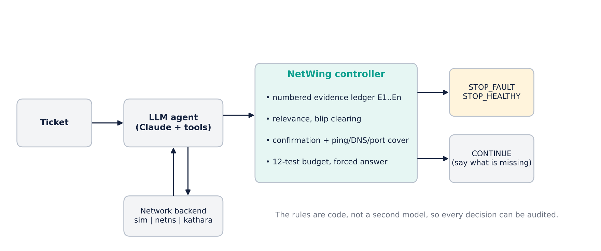
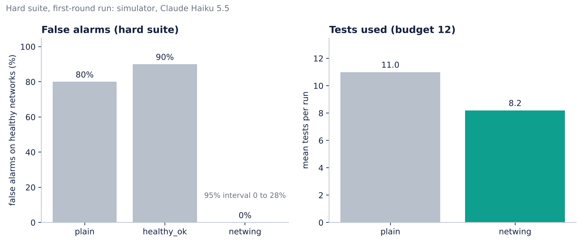
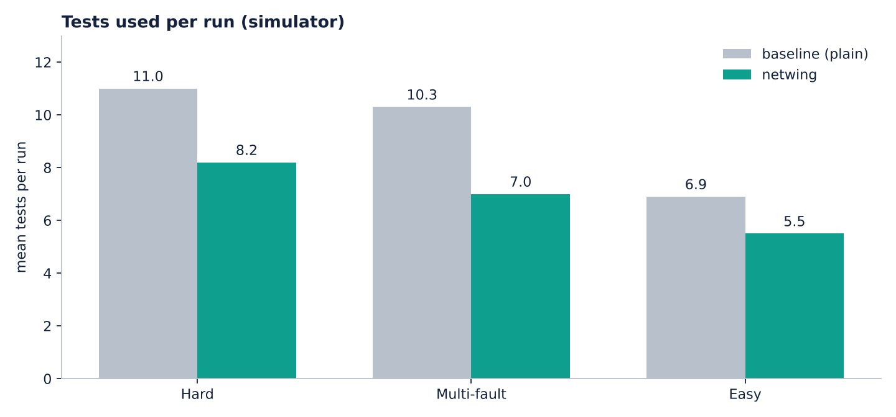
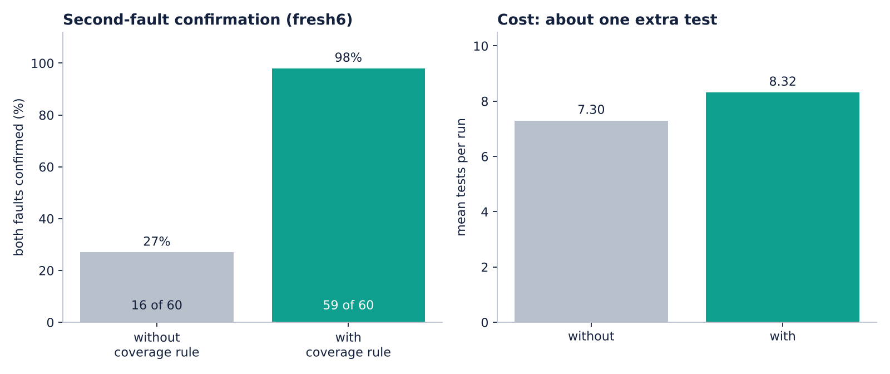
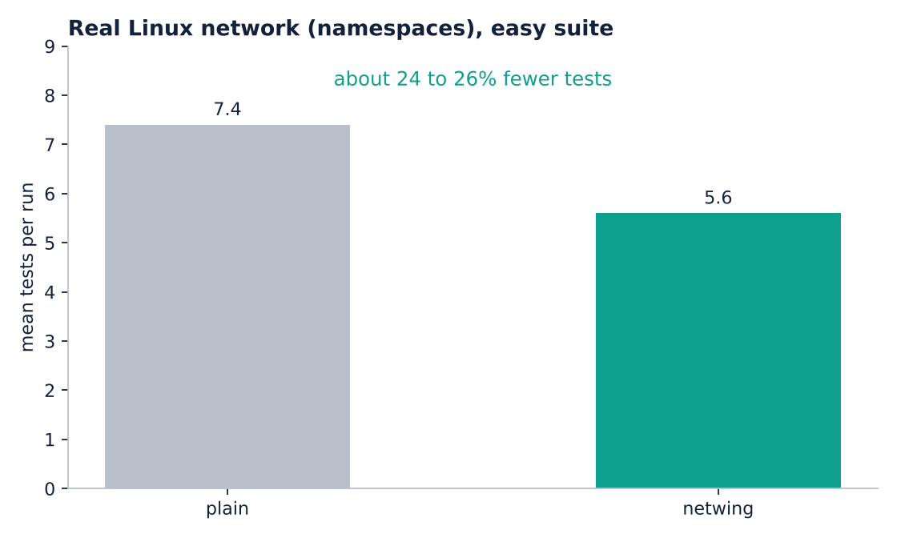
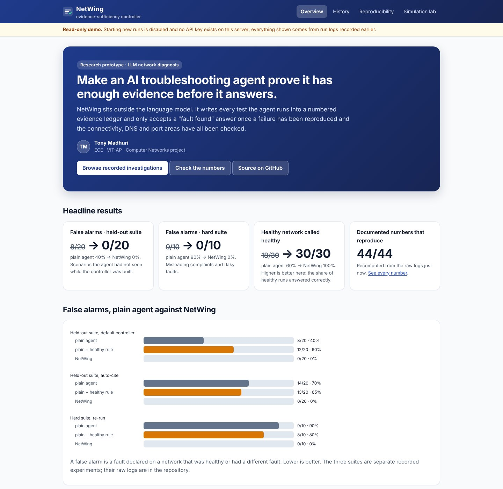
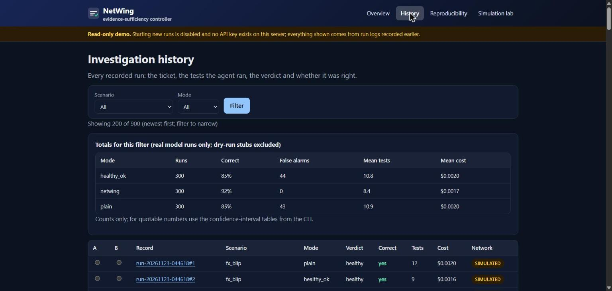
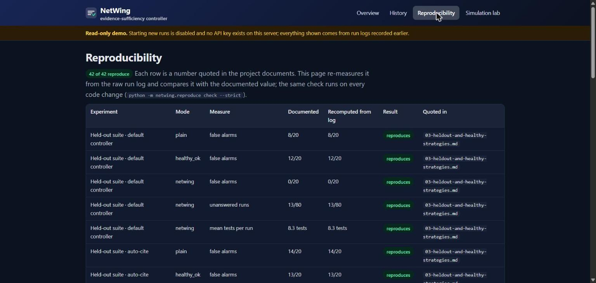

# NetWing

[](https://github.com/tonymadhuri2088-cmd/CN-project/actions/workflows/ci.yml)


[](https://netwing-demo.onrender.com)

**An evidence-sufficiency controller for LLM network-diagnosis agents.**

*A Computer Networks project by **Tony Madhuri** (B.Tech 3rd year, AI&DS, VIT-AP), guided by **Mehbub Alam**.*
**Live read-only demo: <https://netwing-demo.onrender.com>** (the free host sleeps when idle; the first visit can take about a minute).
It answers one question: *does the agent have enough evidence to conclude, or is it about to invent a fault?*

LLM troubleshooting agents are known to "find" a fault on a network that is actually healthy. NetWing sits between the
agent and its conclusion. It numbers every test result, refuses a fault claim that is not backed by a reproduced failure
about the ticket's target, refuses "healthy" before the evidence supports it, and stops the run once the evidence is
sufficient or the test budget is spent. The controller is a transparent rule engine, not another model, so every
decision can be audited.

<p align="center"></p>

```
ticket -> agent (Claude + tools) -> test results -> Controller (evidence ids E1..)
                                                      |-- relevance:     only results about the ticket's target count
                                                      |-- blip clearing: a failure is cleared when the same check then passes twice
                                                      |-- confirmation:  same check fails twice, or same area from another check
                                                      |-- coverage:      ping, DNS and port all tried (DNS-masked checks don't count)
                                                      |-- budget:        12 tests, then stop
                                                      `-- verdict:       CONTINUE / STOP_FAULT / STOP_HEALTHY / STOP_CAP
```

## Results at a glance
Claude Haiku 5.5, simulated network, same 12-test budget for every mode, 95% Wilson intervals. `healthy_ok` is the strong
prompt-only baseline ("the network may be healthy"). Full tables: [docs/research](docs/research/).

| Suite (runs per mode) | plain | healthy_ok | **netwing** |
|---|---|---|---|
| Hard, noisy alerts (40): correct / false alarms / tests | 80% / 80% / 11.0 | 78% / 90% / n/a | **100% / 0% / 8.2** |
| Flaky (20): correct / false alarms / tests | 65% / 70% / 11.7 | 100% / 0% / 11.4 | **100% / 0% / 9.3** |
| Multi-fault (20): all faults found / tests | 70% / 10.3 | 70% / 9.8 | **95% / 7.0** |
| Real Linux network, easy (20): tests | 7.2 | 7.3 | **5.3** (with `--auto-cite`) |

<p align="center"></p>

<p align="center"></p>

### Latest result: the second-fault problem (fresh6)
The controller used to stop after confirming one fault, so a second fault was confirmed in only about a quarter of
double-fault runs. The opt-in coverage rule (`--cover-areas`, with `--tier-claims`) keeps testing while another area
holds an unrepeated failure. On the frozen, pre-registered fresh6 suite (simulator, Claude Haiku 5.5, 60 double-fault
runs per arm) both faults were confirmed in **59 of 60 runs, up from 16 of 60**, for about one extra test per run
(7.30 to 8.32) and no false alarms in 15 healthy runs. It stays **opt-in**: one model, simulator only. Details:
[docs/research/19](docs/research/19-cover-areas-tier-fresh6-results.md).

<p align="center"></p>

### On a real network
The easy suite also ran on real Linux network namespaces (kernel routing, iptables, DNS): NetWing used about 24 to 26%
fewer tests, and the real network exposed a citation failure the simulator hid, which `--auto-cite` fixes.

<p align="center"></p>

The hard row is the first-round run (a re-run gave 78% / 90% for plain and 80% / 80% for `healthy_ok`: the baselines are
statistically indistinguishable). Every number in these tables can be regenerated from the raw logs, see
[Reproduce the numbers](#reproduce-the-numbers).

What is **not** claimed: that NetWing improves multi-fault detection in general, or that it eliminates hallucinated
diagnoses. Rules were first tuned on these suites, so later results come from **frozen, pre-registered** suites
(held-out, fresh2, fresh3). Those showed one confirmed improvement (opt-in hybrid + retest hint: healthy networks
answered correctly 13% to 97%) and several honest negatives (strict claim validation, tiered claims). Read
[the project history](docs/PROJECT_HISTORY.md) for the full story.

## Quick start (Python 3.10+, no API key needed)
```bash
pip install -e ".[dev]"
pytest                                  # 417 tests; real-lab parity tests skip without root
python -m netwing.demo --dry-run        # whole pipeline with a scripted stub: zero API spend
python -m netwing.webui --results results --port 8765   # investigation UI at http://127.0.0.1:8765
```
Real model run on the **simulated** network (set the key in your shell, never in a file):
```bash
pip install anthropic
export ANTHROPIC_API_KEY=...            # PowerShell: $env:ANTHROPIC_API_KEY = "..."
python -m netwing.demo --backend sim --suite hard --repeats 3 --cap 3
```
`--cap` is a hard USD limit; a run that would pass it stops and is marked INCOMPLETE. Real network labs (Linux
namespaces, Kathara): see [SETUP_LINUX.md](SETUP_LINUX.md).

## Reproduce the numbers
Run logs are append-mode and can hold several invocations, so a number is only meaningful with its file, invocation,
mode and metric. `docs/research/claims.json` records exactly that for every documented figure, and one command checks
all of them against the raw logs in `results/`:
```bash
python -m netwing.reproduce check --strict      # 44 documented numbers vs the raw logs; exit 1 on any difference
python -m netwing.reproduce check --strict --claims docs/research/claims_v2.json   # 26 more (fresh4 to fresh6)
python -m netwing.reproduce inventory           # each log split into its invocations
python -m netwing.reproduce table results/fresh2_original.jsonl#2
```
New logs carry an `invocation_id` and a `provenance` block (git commit, configuration hash, Python and package versions,
temperature setting), and `--resume` continues a partly finished log under the same configuration only. CI runs the
check on every push. Which logs are committed and why: [results/README.md](results/README.md).

## Public demo (read-only)

<p align="center"></p>

<table>
<tr>
<td width="50%"><br><sub>Investigation history: every recorded run, with per-mode totals</sub></td>
<td width="50%"><br><sub>Reproducibility: documented numbers re-measured from the raw logs</sub></td>
</tr>
</table>

<sub>The overview is the redesigned page rendered from this repository (read-only mode). The history and reproducibility screenshots come from the hosted demo, which still runs the previous build until it is redeployed.</sub>

The web UI has a read-only mode for public hosting: it shows the recorded investigations, headline results and the reproducibility table,
cannot start runs, and never reads an API key.

```bash
python -m netwing.webui --results results --read-only    # then open http://127.0.0.1:8765
```

Live instance: <https://netwing-demo.onrender.com>. `DEPLOY.md` explains how to host it from the included `Dockerfile` (`render.yaml` for Render, `fly.toml` for Fly.io). Every number on the
Overview page is recomputed from the raw logs when the server starts.

## What is in the repository
| Path | Contents |
|---|---|
| `netwing/controller.py` | The research core: evidence ledger, stop rules, claim gate |
| `netwing/agent.py`, `runner.py`, `demo.py` | Diagnosis loop, experiment matrix, CLI |
| `netwing/sim.py`, `netns.py`, `kathara.py` | Backends: simulator, real Linux namespaces, Kathara labs |
| `netwing/scenarios.py`, `scoring.py` | Scenario suites with ground truth; deterministic scoring (no LLM judge) |
| `netwing/belief.py`, `belief_report.py`, `strategy_replay.py` | Bayesian belief and information gain; offline analysis of saved logs |
| `netwing/final_report.py`, `reproduce.py`, `provenance.py` | Metrics tables with Wilson intervals; regenerate and lock every documented number; run provenance |
| `netwing/webui.py`, `records.py`, `health.py`, `history.py`, `report.py`, `pdfexport.py` | Investigation UI, evidence explorer, health score, history, HTML and PDF reports |
| `tests/` | 417 tests with a fake LLM client; frozen suites and every documented number are pinned by tests |
| `docs/` | [Project history](docs/PROJECT_HISTORY.md), [research results](docs/research/), [full reference](docs/REFERENCE.md) |
| `results/` | Raw JSONL run logs that back documented numbers ([index](results/README.md)) |
| `SECURITY.md` | Threat model, secret handling, web UI protections, spend limits |

## Experiment integrity
- **Opt-in everything.** Defaults are the published rules; every later layer (`--auto-cite`, `--healthy-strategy hybrid`,
  `--retest-hint`, `--validate-claims`, `--tier-claims`, `--allow-inconclusive`) is off unless requested, so no published
  table changes.
- **Freeze, then run.** Validation suites and acceptance criteria are committed before evaluation; a criterion is never
  changed after results exist.
- **Negative results are reported**, and corrections are recorded as errata rather than silent edits.
- **Deterministic scoring** from scenario ground truth; costs capped and logged per run.
- Logs append and runs stop on API errors, so a file can hold several invocations: analyse per invocation and say which
  (`netwing.reproduce` does this and new logs record an invocation id).
- **Audited.** A full audit ([docs/research/07](docs/research/07-comprehensive-audit.md)) reconciled every documented
  number with the logs and hardened the web UI and the lab backends; a scripted-run comparison showed identical
  controller decisions before and after.

## Honest limits
One model (Haiku 5.5); most suites are simulator-only; the real network covers the easy suite; the Kathara backend has
never been run on real Docker; run-to-run variance is large (about 20 points between behaviourally identical
configurations on multi-fault recall), so quote rates per suite and use 15-30 repeats. By default the controller stops once one
fault is confirmed; the opt-in `--cover-areas` rule fixes this on the simulator (fresh6) but is not yet confirmed on a
real network or a second model. A completeness-aware design is analysed in
[docs/research/06](docs/research/06-dcc-architecture-audit.md).

## Roadmap
Second model on the main suites; 30+ repeats; real-network hard and lab scenarios; human-labelled evaluation; a
live read-only probe backend with an alert trigger and streaming view (near real time, planned, not built); run the
Kathara backend; paper. See [the Major-project backlog](docs/research/17-major-project-backlog.md).

## Development
```bash
pip install -e ".[dev,lint,typecheck]"
ruff check netwing tests && mypy && pytest
python -m netwing.reproduce check --strict
```
CI runs lint, type check, tests, the number check and a dry-run on Python 3.10-3.13, plus a Docker build. The container image serves the UI.

For details (every flag, suite, the UI, the real-network setup) see [docs/REFERENCE.md](docs/REFERENCE.md).

## More

- [Architecture](docs/ARCHITECTURE.md) · [NetWing 2.0 roadmap](docs/research/08-netwing-2-roadmap.md) · [Contributing](CONTRIBUTING.md) · [Changelog](CHANGELOG.md) · [Cite](CITATION.cff)
- `make check` runs lint, types, tests (incl. Hypothesis property tests) and the strict reproducibility check.
