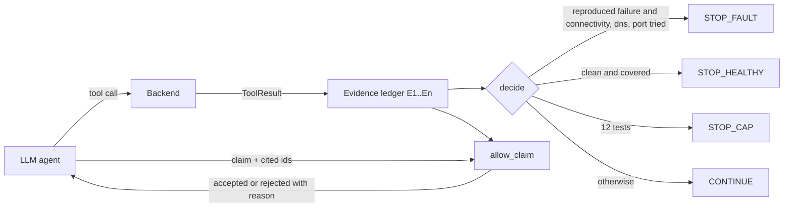
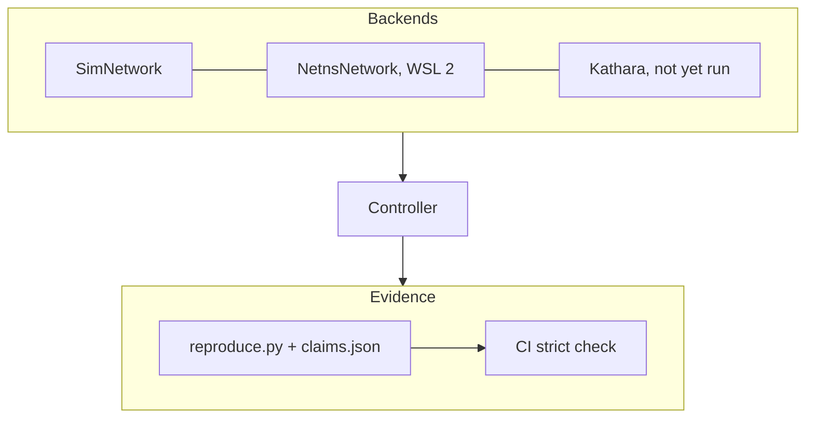

# Architecture

NetWing sits between an LLM diagnosis agent and the network. The model proposes tests and claims; the controller owns the stopping decision and which claims are accepted.

Decision order: healthy, fault, cap, continue. The ledger is append-only, so the verdict after k results depends only on the first k results (a property test checks this).

Opt-in extensions (off by default): `--auto-cite`, `--guide-citations`, `--allow-inconclusive`, `--retest-hint`, `--healthy-strategy hybrid`, `--validate-claims`, `--tier-claims`.
